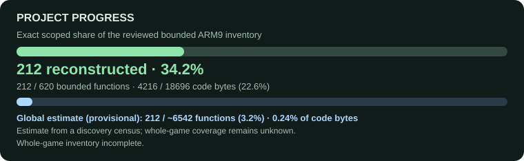

# Plants vs. Zombies DS

A work-in-progress reconstruction of the Nintendo DS game, focused on readable code
for understanding its systems, making mods and supporting future ports.

The verified branch rebuilds the original ROM byte for byte. The research branch
holds unfinished reconstructions, comparison results and behavior tests. The project
is incomplete: the original compiler and the total amount of game code are still
unknown.



<!-- progress:start -->

| Counter | Baseline | Current |
| --- | --- | --- |
| Verified functions / total | 0 / unknown | 8 / unknown |
| Verified code bytes / total | 0 / unknown | 84 / unknown |
| Verified + locally identical draft functions / total | 0 / unknown | 9 / unknown |
| Verified + locally identical draft code bytes / total | 0 / unknown | 112 / unknown |

Since the baseline: 8 additional verified functions (84 code bytes); including locally identical drafts, 9 functions (112 code bytes). Percentage-point changes are unavailable.

Separately, **5 functions pass 1293 sampled behavior calls**. Draft comparisons: 1 locally identical, 7 near and 7 larger differences. These results overlap and must not be added together.

<!-- progress:end -->

Percentages are unavailable until the function inventory is complete. Passing sample
behavior tests does not prove correctness for every input or game state.

## Get started

Use a legally obtained **BWBE revision 0** ROM. Game files, assets and proprietary
compiler tools are not included.

```sh
git clone --branch decomp/strict https://github.com/lasscat/zoydecomp.git decomp/strict
cd decomp/strict
python3 -B tools/workflow.py status
```

For builds, supply the ROM path explicitly:

```sh
python3 -B tools/workflow.py prepare --rom /absolute/path/to/pvz.nds
python3 -B tools/workflow.py verify --rom /absolute/path/to/pvz.nds
```

The current C build uses specific, hash-checked Clang, LLD and formatting tools.
See [build instructions](docs/building.md) for dependencies and input hashes.
Other compiler versions are not accepted automatically.

## Contribute

Start with [CONTRIBUTING.md](CONTRIBUTING.md). Work on connected game systems and
explain uncertain names, layouts and assumptions. Useful work includes binary
analysis, readable reconstructions, behavior tests, tooling and documentation.

- [Current work](docs/next-work.json): RNG state handling and related behavior.
- [Research branch](https://github.com/lasscat/zoydecomp/tree/wip/semantic): saved drafts and tests.
- [How results are measured](docs/results.md): verified builds, behavior tests and code comparisons.
- [Reference source and attribution](docs/donors.md): desktop source used to investigate DS behavior.
- [AI contributor prompt](PROMPT.md): the same contribution and verification rules apply to all agents.

Original development tools, tests and documentation are MIT licensed. Reconstructed
game code and third-party material have separate provenance and notices; see
[LICENSE](LICENSE) and [NOTICE.md](NOTICE.md).
